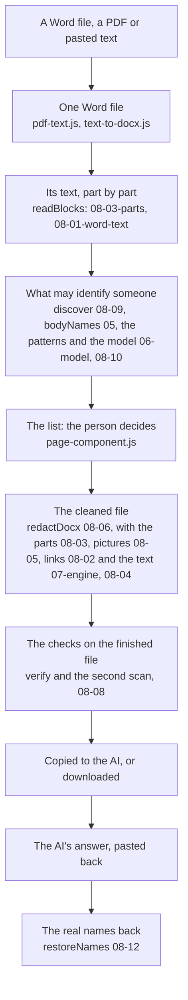

# How InKognito works

InKognito runs entirely in the browser. A lawyer brings a document; the tool finds the people, places and
identifying numbers in it; the lawyer decides on the list; the tool writes a cleaned copy and checks it; and
later it puts the real names back into the AI's answer. This page is the map: the journey of a document, where
each part of it lives, what the tool promises and which test guards each promise. The words it uses are
defined in [CONTEXT.md](CONTEXT.md).

## The journey of a document

Every input becomes a Word file first, so one engine handles all of them. The engine is `engine/*.js`,
concatenated by `scripts/build-engine.js` into `redact-engine.js`, the file the browser loads; the screen is
`page-component.js`, drawn from the template in `index.html` by the runtime in `support.js`.

## Where things live

Each suite runs alone with `node tests/<file>`; all of them with `node tests/run.js`.

| what | where | guarded by |
|---|---|---|
| Reading a Word file into text | `engine/08-01-word-text.js`, `08-03-parts.js` | `structure_t`, `wordtext_t`, `unread_t`, `readers_t` |
| Links, field codes, paths | `engine/08-02-links.js` | `links_t` |
| Tracked changes, comments, writing inside the text | `engine/08-04-runs.js` | `tracked_t`, `passes_t` |
| What pictures carry | `engine/08-05-pictures.js` | `imgmeta_t`, `pictext_t`, `embedded_t` |
| The pipeline that writes the cleaned file | `engine/08-06-redact-docx.js` | `e2e.js`, `chain_t`, `passes_t`; `bench/golden.js`, `bench/lock.js` |
| The checks on the finished file | `engine/08-08-checks.js` | `secondscan_t`, `failopen_t` |
| Finding names without the model | `engine/05-bodynames.js`, `08-09-discover.js`, `05-common.js` | `slots_t`, `slots2_t`, `slots3_t`, `common_t`, `orgs_t` |
| Numbers and identifying details | `engine/06-model.js` (the patterns), `07-engine.js` | `numbers_t`, `forms_t`, `omit_t` |
| The model, and cleaning what it says | `engine/08-10-model-runtime.js`, `06-model.js` | `ner_t`, `readers_t`, `diag_t`, `tok_t` |
| Places | `engine/06-model.js`, `07-gazetteer.js`, `06-atlas-tags.js` | `places_t`, `towns_t`, `atlas_t` |
| Dates | `engine/02-hebrew.js`, `03-dates.js` | `dates_t`, `datewords_t`, `dateforms_t` |
| Citations of other cases | `engine/07-cite.js` | `cite_t` |
| Invented names | `engine/03-fakenames.js` | `aliaskey_t`, `surname_t`, `forbidden_t` |
| Applying the list to the text | `engine/07-engine.js` | `allow_t`, `phrase_t`, `merge_t`, `invisible_t` |
| Restoring the names | `engine/08-12-restore.js` | `restoreforms_t`, `restoreword_t`, `dateback_t` |
| The Word file as a ZIP | `engine/00-head.js`, `01-xml.js` | `zipfuzz_t` |
| The screen | `page-component.js`, `index.html`, `support.js` | the browser tests in `e2e/`, `state_t`, `bindings_t`, `csp_t` |
| Saved cases | `page-component.js`, `page-logic.js` | `profile_t`, `casekey_t`, `lockfile_t`, `e2e/case-store.spec.js`, `e2e/lastlist.spec.js` |
| What a session report may carry | `page-logic.js` | `pagelogic_t`, `logreport_t`, `console_t` |

`engine/06-model.js` still holds four things (the patterns, cleaning the model's output, names after a label,
places); splitting it by concept is the next step, as the Word section (the files `08-01` to `08-13`) was
split on 18.10.

## What the tool promises, and what guards each promise

1. **The document stays in the browser.** Where the page may send anything is fixed by its security policy:
   its own site only (on main also the CDN that serves the model's runtime file, which the hosted build
   removes): `csp_t`, `e2e/csp.spec.js`. A session's report and log carry no text (`pagelogic_t`,
   `logreport_t`), and nothing of the document reaches the console (`console_t`).
2. **A green bar means every value on the list is gone from the whole file:** the text, headers, notes,
   comments, properties, pictures and links. `verify` reads the finished file with its own reader:
   `structure_t`, `links_t`, `imgmeta_t`, `pictext_t`; the gate counts what is left in the benchmark.
3. **Green is not "nothing was missed".** The second scan reads the finished text for what the list missed and
   turns the bar amber (`secondscan_t`). A detector that breaks says so, instead of reporting nothing
   (`failopen_t`).
4. **An invented name is never a word of the document, and one person keeps one invented name across a
   case:** `forbidden_t`, `aliaskey_t`, `surname_t`.
5. **Restore puts back what the tool replaced, and shows any date it moves:** `restoreforms_t`,
   `restoreword_t`, `dateback_t`.
6. **Saved cases stay in this browser, and an exported case file is encrypted:** `casekey_t`, `lockfile_t`,
   `profile_t`.

## How a change is shown to be safe

| check | command | what it holds |
|---|---|---|
| Node suites | `node tests/run.js` | each suite's count is pinned from below (`tests/floors.json`) |
| Browser suites | `npx playwright test --workers=1`; `npm run test:browsers -- --workers=1` | Chrome in CI; WebKit and Firefox before a release |
| The recall gate | `npm run bench:nomodel && node bench/gate.js` | no entity of the benchmark gets worse |
| The golden outputs | `node bench/golden.js` | the redacted text of the 43 benchmark documents, line by line |
| The result lock | `npm run lock` (`--suites` for every document the tests build) | every result and every byte of the output, against the base |
| Mutants | `npm run mutants` | nine quiet passes, each with the suite that notices it gone |
| The complexity guard | `node scripts/complexity.js --check` | no function gets more complex |
| README's figures | `node tests/docs_t.js`; `node bench/second-scan.js --claims README.md` | every figure README quotes is measured |

Releasing: [docs/RELEASING.md](docs/RELEASING.md). Rolling back: [docs/ROLLBACK.md](docs/ROLLBACK.md).

## Who uses what in the engine

The engine's files share one scope and import nothing, so this table is where their dependencies are written
down: for each file, whose names it uses (how many) and who uses its names. `tests/docs_t.js` fails while it
differs from the code.

<!-- engine-map:start (generated by scripts/engine-map.js; do not edit by hand) -->

| file | uses names from | used by |
|---|---|---|
| `00-head.js` | none | 08-03-parts, 08-06-redact-docx, 08-08-checks, 08-10-model-runtime, 08-13-exports |
| `01-xml.js` | none | 08-01-word-text, 08-02-links, 08-03-parts, 08-04-runs, 08-05-pictures, 08-06-redact-docx, 08-13-exports |
| `02-hebrew.js` | 03-dates (4), 06-model (2), 03-fakenames (1) | 03-dates, 03-fakenames, 04-nearmiss, 05-bodynames, 06-model, 07-cite, 07-engine, 08-01-word-text, 08-02-links, 08-04-runs, 08-05-pictures, 08-06-redact-docx, 08-07-report-text, 08-08-checks, 08-09-discover, 08-10-model-runtime, 08-11-entries, 08-12-restore, 08-13-exports |
| `03-dates.js` | 02-hebrew (2) | 02-hebrew, 06-model, 08-12-restore |
| `03-fakenames.js` | 06-model (3), 05-bodynames (2), 02-hebrew (1) | 02-hebrew, 05-bodynames, 06-model, 07-engine, 08-06-redact-docx, 08-08-checks, 08-10-model-runtime, 08-11-entries, 08-12-restore, 08-13-exports |
| `04-nearmiss.js` | 06-model (2), 08-07-report-text (2), 02-hebrew (1), 05-bodynames (1) | 05-bodynames, 06-model, 07-engine, 08-06-redact-docx, 08-08-checks, 08-12-restore, 08-13-exports |
| `05-bodynames.js` | 06-model (9), 03-fakenames (5), 08-07-report-text (2), 02-hebrew (1), 04-nearmiss (1), 05-common (1), 08-11-entries (1) | 03-fakenames, 04-nearmiss, 06-model, 07-cite, 07-engine, 08-04-runs, 08-06-redact-docx, 08-09-discover, 08-11-entries, 08-12-restore, 08-13-exports |
| `05-common.js` | none | 05-bodynames |
| `06-atlas-tags.js` | none | 06-model, 08-13-exports |
| `06-model.js` | 02-hebrew (13), 03-fakenames (10), 05-bodynames (6), 03-dates (5), 06-atlas-tags (2), 07-gazetteer (2), 04-nearmiss (1), 08-11-entries (1) | 02-hebrew, 03-fakenames, 04-nearmiss, 05-bodynames, 07-cite, 07-engine, 07-gazetteer, 08-06-redact-docx, 08-08-checks, 08-09-discover, 08-10-model-runtime, 08-11-entries, 08-12-restore, 08-13-exports |
| `07-cite.js` | 06-model (4), 02-hebrew (1), 05-bodynames (1) | 07-engine, 08-06-redact-docx, 08-08-checks, 08-13-exports |
| `07-engine.js` | 06-model (17), 02-hebrew (15), 03-fakenames (7), 05-bodynames (3), 04-nearmiss (2), 07-cite (1) | 08-02-links, 08-04-runs, 08-06-redact-docx, 08-08-checks, 08-12-restore, 08-13-exports |
| `07-gazetteer.js` | 06-model (2) | 06-model, 08-12-restore |
| `08-01-word-text.js` | 02-hebrew (3), 01-xml (1) | 08-02-links, 08-03-parts, 08-04-runs, 08-06-redact-docx, 08-09-discover, 08-13-exports |
| `08-02-links.js` | 02-hebrew (4), 01-xml (2), 08-01-word-text (2), 07-engine (1), 08-04-runs (1), 08-08-checks (1) | 08-03-parts, 08-06-redact-docx |
| `08-03-parts.js` | 01-xml (7), 08-01-word-text (4), 08-04-runs (3), 08-02-links (2), 00-head (1) | 08-06-redact-docx, 08-13-exports |
| `08-04-runs.js` | 01-xml (4), 02-hebrew (2), 05-bodynames (1), 07-engine (1), 08-01-word-text (1), 08-05-pictures (1) | 08-02-links, 08-03-parts, 08-06-redact-docx, 08-10-model-runtime, 08-13-exports |
| `08-05-pictures.js` | 01-xml (2), 02-hebrew (2) | 08-04-runs, 08-06-redact-docx, 08-13-exports |
| `08-06-redact-docx.js` | 06-model (10), 01-xml (7), 02-hebrew (7), 08-04-runs (7), 08-01-word-text (6), 08-02-links (6), 05-bodynames (4), 07-cite (4), 08-03-parts (4), 08-05-pictures (4), 07-engine (3), 00-head (2), 03-fakenames (2), 04-nearmiss (2), 08-07-report-text (2), 08-08-checks (2), 08-09-discover (1) | 08-13-exports |
| `08-07-report-text.js` | 02-hebrew (4) | 04-nearmiss, 05-bodynames, 08-06-redact-docx, 08-09-discover, 08-13-exports |
| `08-08-checks.js` | 06-model (8), 02-hebrew (4), 07-engine (2), 00-head (1), 03-fakenames (1), 04-nearmiss (1), 07-cite (1), 08-12-restore (1) | 08-02-links, 08-06-redact-docx, 08-13-exports |
| `08-09-discover.js` | 06-model (10), 02-hebrew (5), 05-bodynames (3), 08-01-word-text (1), 08-07-report-text (1), 08-11-entries (1) | 08-06-redact-docx, 08-13-exports |
| `08-10-model-runtime.js` | 06-model (4), 02-hebrew (3), 03-fakenames (3), 00-head (1), 08-04-runs (1), 08-11-entries (1) | 08-13-exports |
| `08-11-entries.js` | 03-fakenames (4), 02-hebrew (1), 05-bodynames (1), 06-model (1) | 05-bodynames, 06-model, 08-09-discover, 08-10-model-runtime, 08-13-exports |
| `08-12-restore.js` | 03-fakenames (8), 06-model (7), 02-hebrew (6), 03-dates (3), 05-bodynames (2), 04-nearmiss (1), 07-engine (1), 07-gazetteer (1) | 08-08-checks, 08-13-exports |
| `08-13-exports.js` | 06-model (15), 02-hebrew (14), 08-10-model-runtime (12), 03-fakenames (10), 05-bodynames (6), 07-cite (6), 07-engine (6), 01-xml (5), 04-nearmiss (5), 08-11-entries (4), 00-head (3), 06-atlas-tags (3), 08-03-parts (3), 08-07-report-text (3), 08-12-restore (3), 08-01-word-text (2), 08-04-runs (2), 08-08-checks (2), 08-05-pictures (1), 08-06-redact-docx (1), 08-09-discover (1) | none |

These 9 files reach one another in a cycle: `02-hebrew`, `03-dates`, `03-fakenames`, `04-nearmiss`, `05-bodynames`, `06-model`, `07-gazetteer`, `08-07-report-text`, `08-11-entries`.

<!-- engine-map:end -->
