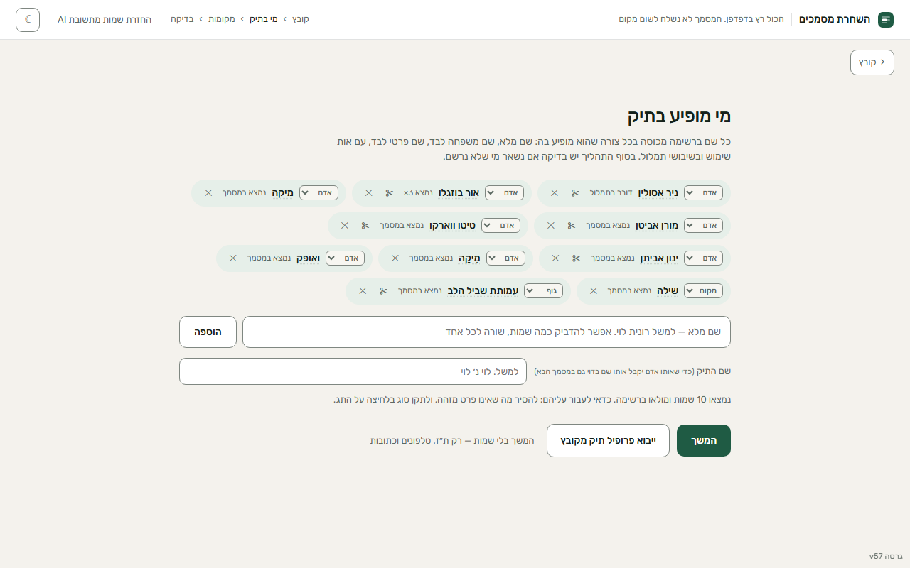
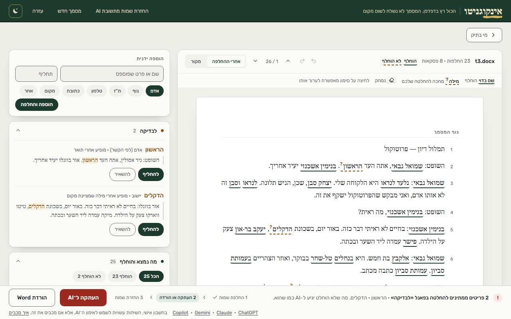
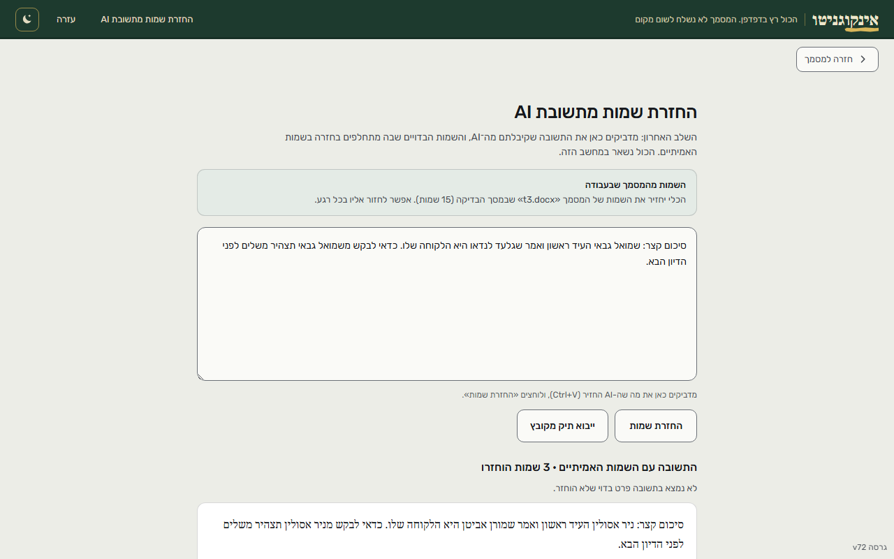

# InKognito

InKognito removes identifying details (people, places, organisations, ID and phone numbers) from Hebrew Word and PDF documents before they are pasted into an AI tool.
Each detail is replaced with a consistent substitute, and when the AI answers, the tool puts the real names back into the answer.
Reading the file, recognising the names and replacing them all run in the browser: the document never leaves the computer.
The hosted service adds sign-in and, only with the user's consent, a usage log without any text from the documents.
It was built for a real client, a lawyer, and shaped by her feedback and her session logs, which record timings and clicks but never text.
The interface is in Hebrew; the Hebrew documentation follows this section.

**Live:** https://inkognito.co.il (served from the `inkognito` branch; `main` holds the tool's code) · **Try it without an account:** https://inkognito.co.il/demo/ (a guided tour on an invented document) · **Demo video (36 s):** [docs/demo/demo.mp4](docs/demo/demo.mp4), on an invented court transcript from the benchmark corpus

  

## How I know it works

- **Benchmark** ([bench/results.md](bench/results.md)): 43 invented documents with 335 keyed entries: 272 identifying details the tool must replace and 63 traps it must leave alone (public bodies, idioms, «פלוני»), built to cover the hard cases (prefix letters, nikud, transcription typos, look-alike surnames, names hidden in headers, footnotes and alt text). With the model on: 2 missed, 2 leaked, 3 false positives.
- It scores **the whole pipeline**, not the model alone: it runs the same chain as the page and checks the output file a user would send, so a leak in any layer counts.
- A **blocking CI gate** ([bench/gate.js](bench/gate.js)) runs the deterministic layers on every change and compares each entity with itself in the baseline on main, so a change cannot pass by rewriting its own; any entity that gets worse fails the build, and a regression is accepted only by naming it with a reason. The model-on run is in CI too, reporting only for now.
- **Model choice** ([docs/model-eval/](docs/model-eval/README.md)): 16 configurations of 9 local Hebrew models, with the decision rule written and committed before any run. Only one passed: DictaBERT-parse's NER head with a corrected tokenizer, which now ships.
- **A real document:** a public Knesset committee transcript ([tests/protocol.txt](tests/protocol.txt), 1,431 words), keyed blind in two independent passes. With every suggestion accepted (measured on 12 October 2026), 1 of its 71 mentions of people is left in the text, 0 of 11 places and 3 of 27 private bodies. It also shows what's next: 9 of its 18 public bodies are replaced too (`npm run bench:protocol`).

## How it's built

- No build step for the page: plain JavaScript, with the interface drawn by React 18 through a small template runtime (`support.js`). The engine is plain files concatenated into one script. On inkognito.co.il every library, font and the model are served from the site itself.
- Name recognition: the NER head of DictaBERT-parse, exported to ONNX, quantized to 8 bits and run in the browser with transformers.js. It is served from this site and checked against a pinned SHA-256 before use.
- Rules, Hebrew prefix handling and a gazetteer run alongside the model; the model only adds suggestions.
- Tests: about 7,800 Node checks and 348 Playwright browser tests in CI, WebKit and Firefox before each release that changes the page, plus the benchmark gates above.
- Developed with Claude Code as the coding agent. Each decision is recorded with its reasons: the model choice in [docs/model-eval/](docs/model-eval/README.md), the rest in the changelog and the code. Who does what, and what the owner catches that the agent and the tests miss: [docs/HOW-IT-WAS-BUILT.md](docs/HOW-IT-WAS-BUILT.md). How real documents are handled while it is built: [docs/DATA-GOVERNANCE.md](docs/DATA-GOVERNANCE.md).

## Known limits

- **Recall depends on the model.** On the 43 benchmark documents the rules alone leave 64 of the 272 details somewhere in the output, in 33 of the documents; with the model, 2. The model is a 185 MB download that the browser keeps after the first time. If it cannot load, the tool says so and the rules still run.
- **The second scan is a net, not a guarantee.** It reads the finished text for what the list missed (ID-like numbers, known first names, a listed name's word on its own). Without the model it turns 10 of the 28 benchmark documents that still leak a person amber; the other 18 still end green. The review screen, and the person reading it, remain the check.
- **What is not read:** text inside pictures (scans, photos, screenshots), a PDF without a text layer, and descriptions that identify someone without a name ("the only notary in the village"). The tool counts the pictures it did not read.
- **It replaces some things it could leave:** 9 of the 18 public bodies in the Knesset transcript are replaced too, which costs the AI context but leaks nothing.
- **Saved cases** (each case's map of real and invented names) are kept in the browser's storage unencrypted, under each account's own key, by decision for now. A case file exported as a backup is encrypted with a password (AES-GCM, PBKDF2 with 600,000 rounds). On a shared computer, «ניקוי התיקים מהמחשב» removes them.
- **Deploys run from the owner's computer.** GitHub also builds every push to the hosted branch and publishes the SHA-256 of every file with a signed attestation, so what the site serves can be checked against the repository: on its first run (13 October 2026), all 146 files GitHub built matched the deployed ones. Moving the deploy itself into that workflow is next.
- **Browsers:** the model needs WebAssembly under a strict policy (Chrome or Edge 97+, Firefox 102+, Safari 16+). In an older browser the rules run alone.
- **No independent security audit or penetration test has been done yet.**

**Licence:** source-available under [PolyForm Shield 1.0.0](LICENSE). Read it before using the code in a product of your own.

---

# אינקוגניטו

כלי שמחליף במסמכי Word ו־PDF, ובטקסט מודבק, שמות ופרטים מזהים בשמות ובפרטים
בדויים לפני שליחה ל־AI, ומחזיר את השמות האמיתיים לתשובה. הזיהוי, ההחלפה
והאימות רצים כולם בדפדפן, ושום מסמך לא נשלח לשרת.

## פריסה

**מאז 6.10.2026 הכלי נמצא ב-https://inkognito.co.il/.** הכתובת הישנה,
https://ombed.github.io/inkognito/, מגישה מ-main את דף ההעברה שבתיקייה `forward/`
(`node scripts/build-forward.js`): `index.html` — בלי תיקים שמורים בדפדפן הוא שולח
מיד ל-inkognito.co.il, ועם תיקים שמורים הוא מציע להוריד את כולם לקובץ אחד, לייבוא שם
ב«ייבוא תיקים מקובץ»; `404.html` — אותו דף, לכל קישור ישן; ו-`sw.js`, שמחליף את עובד
השירות של הכלי, מוחק את המטמונים שלו ואת המודל, ומסיר את עצמו. התיקים השמורים נשארים
במקומם. `.github/workflows/pages.yml` בונה את התיקייה, מריץ עליה את
`e2e/moved.spec.js`, מפרסם אותה, ובודק שהכתובת החיה מגישה את דף ההעברה, גם לקישור
ישן, ואת עובד השירות שלו. לדף ההעברה אין גרסה ואין לו תג `live/vNN`: הגרסאות והתגים
שייכים מעכשיו לפריסות של inkognito.co.il.

קבצי הכלי עצמו יושבים יחד תחת אותה כתובת `https`:

| קובץ | תפקיד |
|---|---|
| `index.html` | הכלי — מבנה ועיצוב |
| `page-component.js` | לוגיקת הממשק, כקובץ שמדיניות האבטחה של הדף מתירה (ולא כטקסט שהופך לקוד) |
| `support.js` | שכבת ההרצה שמרנדרת את הממשק |
| `page-logic.js` | לוגיקת דף שאינה תלויה ב-DOM (דוח הדליפה); נבדקת גם ב-Node |
| `redact-engine.js` | המנוע: זיהוי, החלפה, אימות, DOCX |
| `pdf-text.js` | חילוץ טקסט מ-PDF |
| `text-to-docx.js` | הפיכת טקסט מודבק ל-docx לצורך העיבוד |
| `sw.js` | עובד שירות — שומר את קבצי הכלי במטמון, כדי שייפתח מהר |
| `manifest.webmanifest` | הגדרות התקנה |
| `icon.svg`, `icon-192.png`, `icon-512.png` | אייקונים |
| `vendor/transformers-4.2.0.min.js` | ספריית מודל הזיהוי (transformers.js), מהאתר עצמו ולא מ-CDN |
| `vendor/ort-1.24.0-dev.20251116-b39e144322/ort-wasm-simd-threaded.asyncify.mjs`, `vendor/ort-1.24.0-dev.20251116-b39e144322/ort-wasm-simd-threaded.mjs` | הטוען של ספריית ההרצה; קובץ ה-WebAssembly שלה יורד מ-CDN ונבדק מול SHA-256 נעול |
| `vendor/pdfjs-4.6.82/pdf.min.mjs`, `vendor/pdfjs-4.6.82/pdf.worker.min.mjs` | pdf.js, לקריאת PDF |
| `fonts/rubik-hebrew-300-normal.woff2`, `fonts/rubik-latin-300-normal.woff2`, `fonts/rubik-latin-ext-300-normal.woff2`, `fonts/rubik-hebrew-400-normal.woff2`, `fonts/rubik-latin-400-normal.woff2`, `fonts/rubik-latin-ext-400-normal.woff2`, `fonts/rubik-hebrew-500-normal.woff2`, `fonts/rubik-latin-500-normal.woff2`, `fonts/rubik-latin-ext-500-normal.woff2`, `fonts/rubik-hebrew-600-normal.woff2`, `fonts/rubik-latin-600-normal.woff2`, `fonts/rubik-latin-ext-600-normal.woff2`, `fonts/noto-serif-hebrew-hebrew-400-normal.woff2`, `fonts/noto-serif-hebrew-latin-400-normal.woff2`, `fonts/noto-serif-hebrew-latin-ext-400-normal.woff2`, `fonts/noto-serif-hebrew-hebrew-500-normal.woff2`, `fonts/noto-serif-hebrew-latin-500-normal.woff2`, `fonts/noto-serif-hebrew-latin-ext-500-normal.woff2`, `fonts/FrankRuhlLibre-900-hebrew.woff2` | גופני הכלי, מהאתר עצמו ולא מ-Google Fonts: Rubik לממשק, Noto Serif Hebrew למסמך, Frank Ruhl Libre לשם המוצר |
| `fonts/rubik-LICENSE.txt`, `fonts/noto-serif-hebrew-LICENSE.txt`, `fonts/frank-ruhl-libre-LICENSE.txt` | רישיון הגופנים, SIL Open Font License 1.1 |
| `models/dictabert-parse-ner-37f4d6f/config.json`, `models/dictabert-parse-ner-37f4d6f/tokenizer.json`, `models/dictabert-parse-ner-37f4d6f/tokenizer_config.json`, `models/dictabert-parse-ner-37f4d6f/special_tokens_map.json` | מודל הזיהוי (DictaBERT-parse של Dicta, CC BY 4.0): ההגדרות והטוקנייזר, כמו שהם |
| `models/dictabert-parse-ner-37f4d6f/onnx/model_quantized.onnx.part1`, `models/dictabert-parse-ner-37f4d6f/onnx/model_quantized.onnx.part2`, `models/dictabert-parse-ner-37f4d6f/onnx/model_quantized.onnx.part3`, `models/dictabert-parse-ner-37f4d6f/onnx/model_quantized.onnx.part4` | המשקולות (185MB) בארבעה חלקים; הדף מחבר אותם ובודק את הקובץ המחובר מול SHA-256 נעול |
| `models/dictabert-parse-ner-37f4d6f/NOTICE.md` | הקרדיט, הרישיון ומה שונה במודל |

הכלי מוגש עכשיו ב-inkognito.co.il, מהענף `inkognito`. בכתובת הישנה הוא מתפרסם רק
בחזרה לאחור: ref שאין בו `scripts/build-forward.js`, כמו תג `live/vNN` מלפני המעבר,
נבנה ומתפרסם כמו קודם — רק הקבצים האלה (`node scripts/build-site.js`), בדיקות דפדפן
על התיקייה, ובדיקה שהכתובת החיה מדווחת את הגרסה. חזרה לכלי:
`gh workflow run pages.yml -f ref=live/vNN` (התג האחרון של הכלי לפני המעבר כתוב ב־docs/ROLLBACK.md); חזרה
לדף ההעברה: אותה פקודה בלי `-f ref`. הפרטים ב-`docs/ROLLBACK.md`. שאר המאגר —
בדיקות, בנצ'מרק, `design/`, `docs/` — לא מוגש. קובץ שהכלי טוען חייב להיכנס לרשימה
שבסקריפט, לטבלה הזאת ולבדיקה `tests/site_t.js`, שמשווה ביניהן.

GitHub Pages או כל אירוח סטטי מספיק. **כתובת `https` היא דרישה, לא
המלצה:** מקובץ `file://` הדפדפן חוסם Cache API, IndexedDB ו-`import`
דינמי, ומודל הזיהוי העברי לא נטען בכלל. הכלי מזהה את המצב ואומר אותו.

## פיתוח

המנוע נערך כקבצים תחת `engine/` (מקטע לכל באנר) ומשורשר ל-`redact-engine.js`
ב-`npm run build:engine`; קובץ הקנבס `design/redact.dc.html` נגזר מ-`index.html`
ב-`npm run build:design`. שניהם נבדקים ב-`npm test`, אז עותק שהתיישן הוא
סוללה אדומה.

| פקודה | מה |
|---|---|
| `npm test` | לינט, סוללות Node, בדיקות דפדפן — רץ על כל PR ב-CI |
| `npm run test:browsers` | אותן בדיקות דפדפן במנוע של Safari (WebKit) וב-Firefox, לפני גרסה שמשנה את הדף (פעם אחת במחשב: `npx playwright install webkit firefox`) |
| `npm run lint` | ESLint: שם לא מוגדר, הכרזה כפולה, regex שבור |
| `npm run bump <n>` / `npm run bump fix` | מקדם את ששת אתרי הגרסה יחד: גרסה, או תיקון קטן (vNN.1) |
| `npm run bench` / `bench:nomodel` / `gate` | הבנצ'מרק (ראו `bench/README.md`) |
| `npm run report` | דוח פערים, התמלול האמיתי, זמנים |
| `node scripts/diff-runtime.js` | טביעת האצבע של `support.js` המוטמע, והשוואה לעותק חדש |

עובדים על ענף, לעולם לא ישר על main; כל קומיט משאיר את `npm test` ירוק;
כל פריסה מקדמת גרסה.

## עדכון גרסה

בכל פריסה לקדם את **ששת** המקומות יחד — ארבעה ב-`index.html`, אחד
ב-`sw.js` וטבלת ה-README — בפקודה אחת. `tests/version_t.js`
מוודא שכולם מסכימים. הרשימה מלאה בכוונה: קל לתקן את שני המופעים הגלויים ולפספס
את שניים שיושבים בתוך הלוגיקה.

**גרסה או תיקון קטן** (החלטת הבעלים, 9.10.2026, כמו באפליקציות גדולות):
- `npm run bump <n>` — **גרסה**: אוסף של שיפורים. מקבלת כותרת משלה ב«מה חדש» באתר (`site/changes.html`
  בענף `inkognito`), ומי שעובד בכלי רואה אחרי העדכון את השורה «אינקוגניטו עודכן. מה חדש».
- `npm run bump fix` — **תיקון קטן**: vNN ← vNN.1 ← vNN.2. מפתח המטמון והשבב זזים, כי בלי מספר חדש הדפדפן
  שומר את הקבצים הישנים, אבל השורה «עודכן» לא מופיעה. ב«מה חדש» הוא שורה אחת תחת הגרסה הנוכחית,
  «תיקוני באגים קטנים» עם התאריך, ותיקון שלא משנה כלום למי שעובד בכלי לא נכתב שם בכלל. ב-`CHANGELOG.md`
  כל תיקון מקבל כותרת משלו (`## vNN.1`), כי שם הרשימה הטכנית המלאה.

| קובץ | שורה | המחרוזת | תפקיד |
|---|---|---|---|
| `index.html` | 1411 | `
גרסה v75.1
` | השבב התחתון — מה שנראה על המסך |
| `index.html` | 297 | `console.log("… גרסה v75.1")` | שורת הפתיחה בקונסול |
| `index.html` | 350 | `if(served==="v75.1") return;` | **בדיקת ההשוואה** מול מה שהעובד מגיש |
| `index.html` | 351 | `el.innerHTML='גרסה v75.1 · …'` | תווית האזהרה שמוצגת כשיש פער |
| `sw.js` | 8 | `const V="hedact-v75.1";` | מפתח המטמון |

מספרי השורות נכונים לגרסה v75.1 והם עזר בלבד — לחפש את המחרוזת, לא לסמוך
על המספר.

**בדיקת ההשוואה (`if(served===…)`, השורה השלישית בטבלה) היא הכי קלה לפספוס, והפספוס שקט-למחצה.** אם השבב והקונסול
יעלו לגרסה החדשה וההשוואה תישאר על הישנה, האזהרה «רענון בלי מטמון»
תופיע בכל טעינה גם כשהכל תקין. כלומר בדיוק המנגנון שנועד להסגיר מטמון
ישן הופך לרעש קבוע, ומאותו רגע הוא כבר לא מסגיר כלום.

אם יישכח `sw.js`, השבב התחתון יציג את הגרסה הקודמת לצד «רענון בלי
מטמון» ויסגיר את הפער מעצמו. עובד השירות עובד רשת-קודם על קבצי הכלי,
כך שעדכון מגיע בטעינה הראשונה ולא בשנייה.

## מה נטען מהרשת

באתר inkognito.co.il הכלי לא פונה לאתרים אחרים: הספריות, הגופנים, ספריית ההרצה של המודל
והמודל עצמו (185MB) מגיעים מהאתר, והדף רשאי לפנות רק לאתר ולשירות ההתחברות. אף בקשה לא מכילה
דבר מהמסמך. המודל יורד פעם אחת ונבדק מול SHA-256 נעול. הכלי צריך חיבור כדי להיפתח, כי בכל
פתיחה נבדקת הכניסה לחשבון. איך המודל נבחר, מה עוד נבדק ולמה: `docs/model-eval/README.md`, עם
כל הנתונים.

## בדיקת קבלה

1. השבב התחתון מציג את הגרסה החדשה מיד אחרי פריסה, בלי לנקות מטמון
2. אין `{{ }}` על המסך — אף אחד מהם
3. «מודל זיהוי עברי מקומי» דלוק → גרירת docx → המודל יורד ומסיים בלי שגיאה
4. בקונסול: `טוקנייזר: … JSON תקין ✓` ואחריו שורת `זיהוי:`
5. רשימת «מי בתיק» מתמלאת בשמות מהמסמך
6. החלפת מסמך באמצע סריקה — שמות מהראשון לא נכנסים לשני
7. מ-`file://` מופיעה הודעה מסודרת
